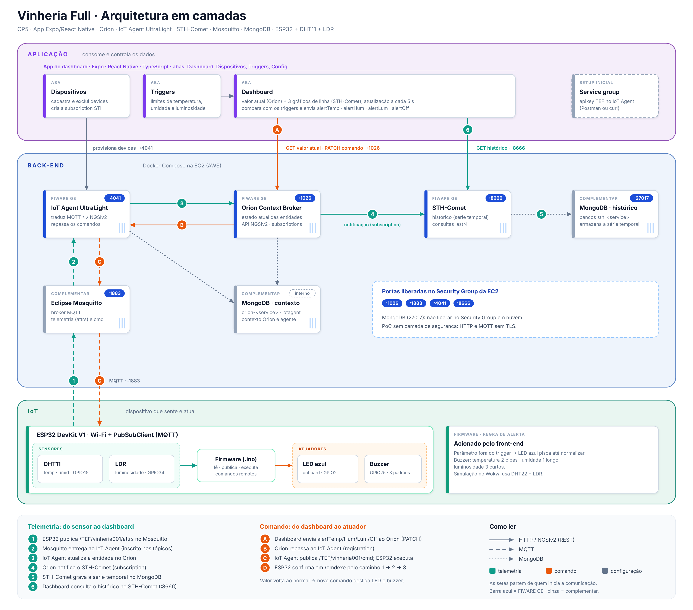

# Vinheria Full (CP5)

Monitoramento de temperatura, umidade e luminosidade de vinherias com ESP32, FIWARE e um dashboard mobile. Quando um valor sai do trigger, o dashboard aciona o LED azul e o buzzer do ESP32 remotamente, e o alerta dura até o valor normalizar.


## Integrantes

| Nome completo | RM |
|---|---|
| Arthur Nepomuceno Dias Gomes | `572626` |
| Davi Yuu Santos Toyota | `565557` |
| Felippe Tuma Costa | `569459` |
| Felipe Santana Motta | `570550` |
| Renan Martins da Silva | `569549` |
| Yan da Silva Lima | `572373` |

Os nomes vêm do cabeçalho de `firmware/vinheria_full/vinheria_full.ino`.

## Links

| Item | Link |
|---|---|
| Simulação no Wokwi (LDR + DHT22) | [`Link da Simulação no Wokwi`](https://wokwi.com/projects/479272509375634433) |
| Vídeo | [`Link do Vídeo no YouTube`](https://youtube.com/shorts/YxmTiEa6N90) |
| Dashboard | Código em [`dashboard/`](dashboard/). É um app Expo, aberto no celular com o Expo Go. |

## Documentação

| Documento | Conteúdo |
|---|---|
| [docs/arquitetura.md](docs/arquitetura.md) | Camadas, fluxos e decisões |
| [docs/manual-hardware.md](docs/manual-hardware.md) | Componentes, ligação, gravação do firmware |
| [docs/manual-software.md](docs/manual-software.md) | FIWARE na EC2, provisionamento, dashboard |
| [docs/alertas-e-triggers.md](docs/alertas-e-triggers.md) | Anomalia, LED, buzzer e comando do front-end |
| [docs/encapsulamento.md](docs/encapsulamento.md) | Caixa 3D e montagem |
| [wokwi/README.md](wokwi/README.md) | Simulação |

## 1. Descrição da solução

Uma vinheria precisa manter a adega dentro de faixas de temperatura, umidade e luz. Fora delas o vinho se degrada, e quem cuida da adega só percebe quando passa por lá.

O sistema funciona assim:
- O ESP32 lê um DHT11 (temperatura e umidade) e um LDR (luminosidade) e publica os valores por MQTT no FIWARE.
- O FIWARE guarda o valor atual no Orion e o histórico no STH-Comet.
- O dashboard mostra os valores atuais e gráficos do histórico, cadastra devices e permite ajustar os triggers.
- Quando um valor sai do trigger, o dashboard envia um comando ao ESP32. O LED azul (GPIO2) pisca e o buzzer toca um padrão diferente para cada anomalia, até o valor voltar ao normal.

Triggers padrão:

| Métrica | Mínimo | Máximo | Unidade |
|---|---|---|---|
| Temperatura | 10 | 30 | °C |
| Umidade | 60 | 80 | % |
| Luminosidade | 0 | 40 | % (0 a 100) |

Os limites do firmware são os mesmos, fixos no código: temperatura de 10 a 30 °C, umidade de 60 a 80 % e luminosidade de 0 a 40 %. Os triggers editados no app não chegam ao firmware. Veja [docs/alertas-e-triggers.md](docs/alertas-e-triggers.md).

## 2. Arquitetura em camadas

[](docs/imgs/arquitetura/arquitetura-vinheria.png)

*Fonte editável: [`arquitetura-vinheria.svg`](docs/imgs/arquitetura/arquitetura-vinheria.svg).* Os fluxos de telemetria e de comando estão em [docs/arquitetura.md](docs/arquitetura.md).

Sobre a arquitetura:
- O app lê o valor atual direto no Orion (1026) e o histórico no STH-Comet (8666). Os cadastros de devices vão ao IoT Agent (4041).
- No `docker-compose.yml`, o Orion grava no MongoDB histórico (`-dbhost mongo-db-historical`) e o IoT Agent no MongoDB interno.
- O ESP32 confirma cada comando em `/TEF/vinheria001/cmdexe`.

## 3. Hardware

| Componente | Função |
|---|---|
| ESP32 DevKit V1 | Microcontrolador com Wi-Fi |
| DHT11 | Temperatura e umidade (no Wokwi, um DHT22) |
| Módulo LDR | Luminosidade, saída analógica |
| Buzzer | Alerta sonoro |
| LED azul | LED embutido do DevKit V1, no GPIO2 |
| Mini protoboard e fios | Ligações |

Pinagem implementada em `vinheria_full.ino`:

| Sinal | GPIO | Observação |
|---|---|---|
| DHT (dados) | 15 | `DHT_PIN` |
| LDR (saída analógica) | 34 | `LDR_PIN`, ADC de 12 bits |
| LED azul | 2 | `LED_AZUL`, LED onboard |
| Buzzer | 25 | `BUZZER`, usa `tone()` |

Esquema de ligação e montagem em [docs/manual-hardware.md](docs/manual-hardware.md). A ligação simulada está em [`wokwi/diagram.json`](wokwi/diagram.json).

## 4. Lógica de triggers e alertas

| Anomalia | LED azul (GPIO2) | Buzzer (GPIO25) | Comando do front-end |
|---|---|---|---|
| Temperatura fora do trigger | Pisca a cada 350 ms | 2 bipes médios (1800 Hz) | `alertTemp` |
| Umidade fora do trigger | Pisca a cada 350 ms | 1 som longo (1000 Hz) | `alertHum` |
| Luminosidade fora do trigger | Pisca a cada 350 ms | 3 bipes curtos (2400 Hz) | `alertLum` |
| Valores normais | Apagado | Silêncio | `alertOff` |

O alerta termina quando o front-end envia `alertOff` ou quando a leitura local da métrica volta ao normal. Quando há mais de uma anomalia, o LED pisca e o buzzer toca um padrão por vez, na ordem temperatura, umidade, luminosidade. Tabela completa em [docs/alertas-e-triggers.md](docs/alertas-e-triggers.md).

## 5. Dashboard

App Expo (React Native e TypeScript) em [`dashboard/`](dashboard/), com quatro abas:

| Aba | Funções |
|---|---|
| Dashboard | Valores atuais, gráficos do histórico (10, 30 ou 60 leituras, atualização a cada 5 s), faixa de alerta e botões de teste manual |
| Dispositivos | Cadastrar, listar, selecionar e excluir devices no IoT Agent |
| Triggers | Editar mínimo e máximo de cada métrica e ligar ou desligar os alertas automáticos |
| Config | IP do FIWARE, `fiware-service`, `fiware-servicepath`, tipo da entidade e teste de conexão com 4041, 1026 e 8666 |

A luminosidade chega do ESP32 já em % (0 a 100), convertida no firmware por `lerLuminosidadePct`, e o app a usa sem conversão.

## 6. Manual de instalação e operação

### Hardware

Pré-requisitos: Arduino IDE 2.x com o pacote de placas ESP32, e as bibliotecas `PubSubClient` (2.8 ou superior) e `DHTesp`.

```text
1. Monte o circuito conforme docs/manual-hardware.md.
2. Abra firmware/vinheria_full/vinheria_full.ino na Arduino IDE.
3. Preencha WIFI_SSID, WIFI_PASSWORD e MQTT_BROKER (IP da EC2). Não versione esses valores.
4. Selecione a placa "ESP32 Dev Module" e a porta serial.
5. Grave e abra o monitor serial em 115200.
```

Passo a passo completo em [docs/manual-hardware.md](docs/manual-hardware.md).

### Software

Pré-requisitos: uma instância Ubuntu Server LTS na AWS (mínimo 1 vCPU, 1 GB de RAM e 20 GB de disco), com as portas 1883, 4041, 8666 e 1026 liberadas, e Node.js 18 ou superior na máquina do dashboard.

```bash
# Na EC2: instalar o Docker e subir a stack
sudo apt update
sudo apt install docker.io docker-compose
cd fireware
sudo docker-compose up -d
```

```bash
# Na máquina de desenvolvimento: rodar o dashboard
cd dashboard
npm install
npx expo start
```

O `mosquitto.conf` já está em `fireware/mosquitto/`. Antes de usar, é preciso provisionar o service group com apikey `TEF` e cadastrar o device. O passo a passo, com os comandos, está em [docs/manual-software.md](docs/manual-software.md).

## 7. Encapsulamento

Duas caixas impressas em 3D, modeladas no Onshape: a caixa principal (base e tampa) abriga ESP32, DHT11, LDR e buzzer, com o logo de ovelha em relevo na tampa. A segunda caixa guarda a mini protoboard e os fios, aberta em cima, e a primeira encaixa por cima dela. Cada peça tem seu STL. Detalhes em [docs/encapsulamento.md](docs/encapsulamento.md).

## 8. Estrutura do repositório

```text
.
├── README.md
├── docs/
│   ├── arquitetura.md
│   ├── manual-hardware.md
│   ├── manual-software.md
│   ├── alertas-e-triggers.md
│   ├── encapsulamento.md
│   └── imgs/                     # arquitetura/, fluxo/ (.png e .svg), dashboard/ e prototipo/ (capturas e fotos)
├── firmware/vinheria_full/vinheria_full.ino
├── dashboard/                    # app Expo
│   ├── requirements.txt          
│   ├── package.json
│   └── src/{app,components,lib}/
├── fireware/                     # docker-compose.yml, mosquitto/mosquitto.conf e nginx/default.conf
└── wokwi/                        # diagram.json, README.md
```

A pasta `fireware/` mantém o nome atual do repositório.

## 9. Diferenciais

- Alerta remoto pelo front-end com LED e buzzer não bloqueantes, usando `millis()`.
- Três padrões sonoros distintos, um por anomalia.
- Dashboard mobile com cadastro de dispositivos, histórico do STH-Comet e triggers editáveis.
- Proxy Nginx que libera CORS para o IoT Agent e o STH-Comet, o que permite abrir o dashboard no navegador.
- Reconexão de Wi-Fi e MQTT sem travar o loop do firmware.
- Encapsulamento em duas peças com logo próprio.

## 10. Evidências

| Arquivo | Legenda |
|---|---|
| `docs/imgs/dashboard/dashboard.png` | Aba Dashboard com os três gráficos |
| `docs/imgs/dashboard/dispositivos.png` | Cadastro de device |
| `docs/imgs/dashboard/triggers.png` | Edição dos triggers |
| `docs/imgs/prototipo/montagem.png` | Foto do circuito montado |
| `docs/imgs/prototipo/encapsulamento.png` | Foto da caixa montada |
| `docs/imgs/prototipo/monitor-serial.png` | Monitor Serial com o projeto em funcionamento |

## 11. Solução de problemas

| Sintoma | Causa provável | Correção |
|---|---|---|
| Mosquitto não sobe | O `docker-compose up` rodou fora de `fireware/`, ou o `mosquitto.conf` não está em `fireware/mosquitto/` (o Docker cria uma pasta no lugar do arquivo) | Rodar de dentro de `fireware/` e ver `docker logs fiware-mosquitto`, conforme [manual-software.md](docs/manual-software.md) |
| ESP32 conecta no MQTT mas nada aparece no Orion | Service group `TEF` não provisionado | Provisionar o service group |
| Comando retorna `unknown command` em `/cmdexe` | Firmware antigo sem os comandos `alert*` | Regravar o `.ino` atual |
| Dashboard dá erro de rede | IP errado, `localhost` ou celular em outra rede | Usar o IP da EC2 na aba Config |
| Histórico vazio ou com pontos duplicados | Subscription ausente, ou duplicada (Postman e app) | Manter uma subscription por entidade |
| Luminosidade sempre em alerta | Triggers do app fora da faixa real do ambiente, ou LDR com polaridade invertida | Conferir os triggers e a polaridade do módulo |
| `Falha na leitura do DHT` no serial | DHT11 mal ligado, ou `DHT_TYPE` errado | Conferir o pino 15 e o tipo do sensor |
| Simulação no Wokwi não compila | `libraries.txt` lista `dhtESP32-rmt` | Usar `DHTesp` |
| QR Code do Expo não conecta | Celular fora da rede do computador | `npx expo start --tunnel` |
| Comportamento estranho após atualizar o app | Cache do Metro | `npx expo start -c` |

## 12. Referências e créditos

- Repositório de referência do professor Fabio Cabrini, licença MIT: https://github.com/fabiocabrini/fiware . A stack Docker e a abordagem de dashboard com STH-Comet partem dele. Os textos deste repositório são escritos pelo grupo.
- FIWARE: Orion Context Broker, IoT Agent UltraLight, STH-Comet.
- Eclipse Mosquitto, Expo, React Native, PubSubClient, DHTesp.
- O dashboard parte de um template Expo (licença MIT, em `dashboard/LICENSE`).
