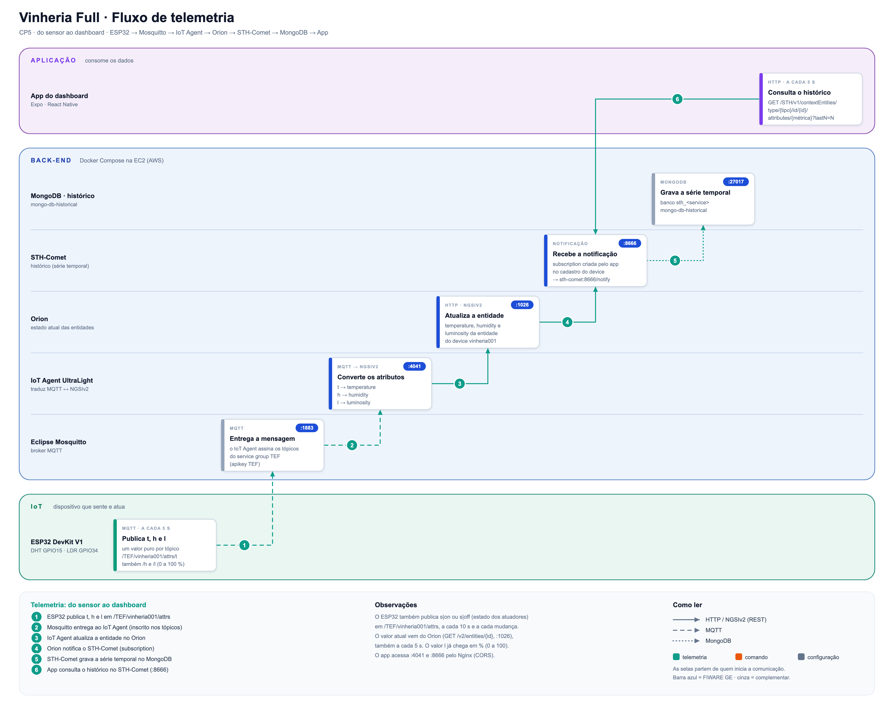
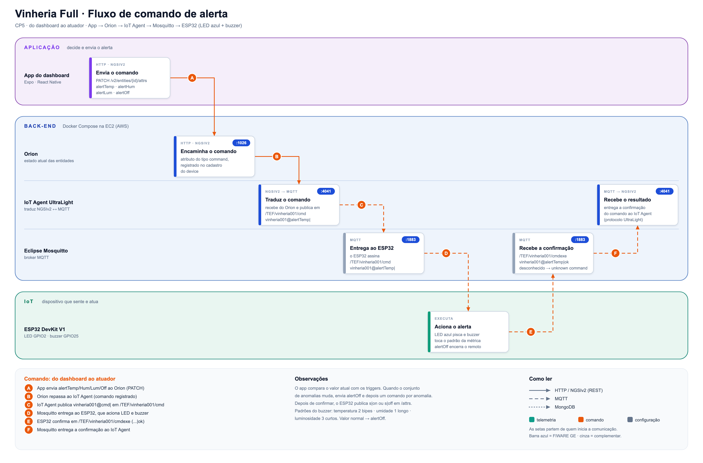

# Arquitetura

Voltar ao [README](../README.md). Pinos e tópicos citados aqui vêm de `firmware/vinheria_full/vinheria_full.ino`. Portas e serviços vêm de `fireware/docker-compose.yml` e `fireware/nginx/default.conf`.

*Fonte editável: [`arquitetura-vinheria.svg`](imgs/arquitetura/arquitetura-vinheria.svg).

## Camadas

| Camada | Componentes | Responsabilidade |
|---|---|---|
| IoT | ESP32 DevKit V1, DHT11 (GPIO15), LDR (GPIO34), LED azul (GPIO2), buzzer (GPIO25) | Medir, publicar, receber comandos e acionar LED e buzzer |
| Comunicação | MQTT sobre Wi-Fi, Mosquitto (1883), tópicos UltraLight 2.0 | Transportar telemetria e comandos |
| Back-end | IoT Agent UltraLight (4041), Orion (1026), STH-Comet (8666), dois MongoDB, Nginx | Traduzir MQTT em NGSIv2, guardar o estado atual e o histórico |
| Aplicação | App Expo / React Native (abas Dashboard, Dispositivos, Triggers, Config) | Cadastrar devices, mostrar gráficos, ajustar triggers e acionar alertas |

## Fluxo de telemetria (1 a 6)

*Fonte editável: [`fluxo-telemetria.svg`](imgs/fluxo/fluxo-telemetria.svg).*

1. A cada 5 s o ESP32 publica um atributo por tópico: `t` (temperatura), `h` (umidade) e `l` (luminosidade em %, 0 a 100, já convertida no firmware por `lerLuminosidadePct`).
2. O Mosquitto entrega ao IoT Agent, que se inscreve nos tópicos do service group `TEF`.
3. O IoT Agent converte `t`, `h` e `l` em `temperature`, `humidity` e `luminosity` e atualiza a entidade no Orion.
4. A subscription criada pelo app no cadastro manda cada mudança ao STH-Comet (`http://sth-comet:8666/notify`).
5. O STH-Comet grava o histórico no MongoDB.
6. O app consulta o histórico no STH-Comet e o valor atual no Orion, a cada 5 s.

## Fluxo de comando (A a F)

*Fonte editável: [`fluxo-comando-alerta.svg`](imgs/fluxo/fluxo-comando-alerta.svg).*

1. O app calcula as anomalias comparando o valor atual com os triggers. Quando o conjunto muda, envia `alertOff` e depois um comando por anomalia (`alertTemp`, `alertHum`, `alertLum`).
2. O Orion repassa ao IoT Agent, porque os comandos foram registrados no cadastro do device.
3. O ESP32 recebe `vinheria001@alertTemp|`, liga o alerta, responde `vinheria001@alertTemp|ok` em `/cmdexe` e republica o estado dos atuadores (`s|on` ou `s|off`).

## Decisões de projeto

| Decisão | Motivo |
|---|---|
| UltraLight 2.0 sobre MQTT | Mensagens curtas, adequadas ao ESP32, e comandos nativos no IoT Agent |
| Um tópico por atributo | O firmware publica valor puro, sem montar `chave\|valor` |
| STH-Comet para o histórico | O enunciado pede a API 8666 |
| Alerta em `millis()`, sem `delay()` | O loop continua lendo sensores, recebendo MQTT e tocando o buzzer durante o alerta |
| Reconexão Wi-Fi e MQTT com intervalo | Uma queda de rede não trava o LED nem o buzzer |
| Buffer MQTT de 256 bytes | O padrão do PubSubClient é pequeno demais para as mensagens |
| Nginx na frente do IoT Agent e do STH-Comet | Adiciona CORS. O Orion já tem `-corsOrigin __ALL` |
| Triggers no app | O usuário ajusta os limites sem regravar o firmware (veja a limitação em [alertas-e-triggers.md](alertas-e-triggers.md)) |

## O papel do Nginx

| Porta do Nginx | Encaminha para | Quem usa |
|---|---|---|
| 4041 | `iot-agent:4041` | App (cadastro de devices) |
| 8666 | `fiware-sth-comet:8666` | App (histórico, `lastN`) |
| 1026 | Não passa pelo Nginx | App, direto no Orion (`-corsOrigin __ALL`) |

O app monta todas as URLs como `http://<host>:<porta>` (`fiware.ts`, `PORTS`). Por isso o Orion (1026) é acessado direto, e o IoT Agent e o STH-Comet são acessados pelas portas do Nginx. O Mosquitto (1883) é usado só pelo ESP32 e pelo IoT Agent.

O Nginx escuta nas portas 4041 e 8666 e encaminha para o IoT Agent e o STH-Comet. Ele responde ao preflight `OPTIONS` e acrescenta os cabeçalhos CORS, incluindo `fiware-service` e `fiware-servicepath`. Sem ele, o dashboard aberto no navegador (`npx expo start --web`) seria bloqueado. No compose, o IoT Agent só tem `expose` e o STH-Comet não publica porta, então o Nginx é o único caminho externo para os dois.

## Segurança

A stack é uma prova de conceito, sem autenticação nas APIs. Recomendações:
- Limitar o grupo de segurança da EC2 aos IPs do grupo.
- Não expor o MongoDB (27017). O compose atual mapeia essa porta.
- Tirar as senhas do MongoDB do `docker-compose.yml` e usar um `.env` fora do Git.
- Considerar usuário e senha no Mosquitto (`MQTT_USER` e `MQTT_PASSWORD` já existem no firmware).

## Conferência da imagem contra o código

| Item | Valor no código |
|---|---|
| Portas | IoT Agent 4041, Orion 1026, STH-Comet 8666, Mosquitto 1883 |
| Tópicos | `/TEF/vinheria001/attrs`, `/cmd`, `/cmdexe` |
| Pinos | DHT 15, LDR 34, LED 2, buzzer 25 |
| Comandos | `alertTemp`, `alertHum`, `alertLum`, `alertOff` |
| Nginx | Existe em `fireware/nginx/default.conf` |
| Bancos | O Orion usa o MongoDB histórico, o IoT Agent usa o interno |
| Buzzer | Controlado com `tone()`, funciona com buzzer passivo |
